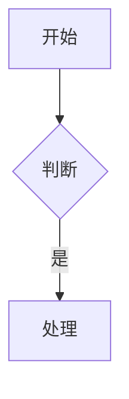

# ndd-markdown-preview

Notepad--（ndd）的 Markdown 实时预览插件。在编辑器右侧挂载停靠面板，实时渲染
**Markdown / Mermaid / LaTeX**，渲染库全部内嵌，完全离线可用。

---

> [!WARNING]
> **本项目代码由 AI（DeepSeek V4.1 Flash）生成**，未经人工完整审计，可能存在
> 错误、缺陷或安全隐患。**请在正式使用前自行 review 代码**，确认无误后再使用。
> 由此产生的任何后果由使用者自行承担。

---

## 下载

**[ndd-markdown-preview.dll](https://github.com/myd510/ndd-markdown-preview/releases/latest/download/ndd-markdown-preview.dll)** —— v1.0（Windows x64，Qt 5.15.2）

其他版本见 [Releases](https://github.com/myd510/ndd-markdown-preview/releases)。

---

## 功能

- **实时预览** —— 内容改动自动刷新，也可手动刷新
- **Markdown 全扩展** —— GFM 表格、任务列表、脚注、定义列表、缩写、属性、容器、上下标、高亮、Emoji、目录、GitHub 警告块、复杂表格
- **Mermaid 全图类型** —— 21 种图表
- **LaTeX 公式** —— KaTeX，行内 `$...$` 与块级 `$$...$$`
- **代码高亮** —— highlight.js，随主题切换明暗
- **主题系统** —— 10 套 Markdown 主题 + 13 套 Mermaid 配色
- **导出 HTML** —— 样式内联的独立文件

---

## 用法

1. 把 `ndd-markdown-preview.dll` 放进 Notepad-- 的 `plugin` 目录
2. 重启 Notepad--

打开 `.md` 文件后，从插件菜单选择「预览 Markdown」（`Ctrl+Alt+P`）。

| 菜单项 | 快捷键 |
|---|---|
| 预览 Markdown | `Ctrl+Alt+P` |
| 刷新预览 | `F5` |
| 自动刷新 / Markdown 主题 / Mermaid 主题 | — |
| 放大 / 缩小 / 重置缩放 | `Ctrl+=` / `Ctrl+-` |
| 导出为 HTML | — |

> 插件依赖 QtWebEngine。若你的 Notepad-- 未自带，需先用 Qt 的 `windeployqt`
> 把 QtWebEngine 运行期文件（`QtWebEngineProcess.exe`、`resources\*.pak`、
> `icudtl.dat`、`translations\qtwebengine_locales\`）部署到 Notepad-- 目录，
> 否则预览面板会空白。

---

## 支持的语法

**Markdown**：标题、强调、引用、列表、代码块、分隔线、链接图片、转义、内联 HTML；
GFM 表格 / 任务列表 / 删除线 / 自动链接；脚注、定义列表、缩写、属性 `{.class}`、
容器 `::: tip`、上下标 `H~2~O` `x^2^`、高亮 `==x==`、插入 `++x++`、Emoji、
目录 `[TOC]`、GitHub 警告块 `> [!NOTE]`、复杂表格（多行单元格 / 跨行 / 多表体）。

**Mermaid**：流程图、时序图、类图、状态图、ER 图、甘特图、饼图、用户旅程、Git 图、
思维导图、时间线、象限图、桑基图、XY 图、块图、数据包图、C4、需求图、雷达图、
树图、架构图。

````markdown

````

**LaTeX**：

```markdown
行内：$E = mc^2$

块级：
$$
\int_{0}^{\infty} e^{-x^2}\,dx = \frac{\sqrt{\pi}}{2}
$$
```

> Mermaid 对中文有三处限制：`sankey-beta` 节点名不支持中文；`xychart-beta` 的 x 轴
> 中文标签需加引号；`requirementDiagram` 的 `text:` 需加引号。

---

## 主题

Markdown 主题与 Mermaid 主题**相互独立**，各自在菜单里单独切换，选择会被记住。
详见 [docs/themes.md](docs/themes.md)。

### Markdown 主题（10 套）

| 主题 | 风格 |
|---|---|
| GitHub 浅色（默认） | GitHub 官方排版，清爽 |
| GitHub 深色 | GitHub 官方排版，暗色 |
| Water 浅色 / 深色 | 极简无类名，蓝色点缀 |
| Sakura 粉樱 / 深色 / 大地 | 樱花粉 / 暗色 / 护眼大地色 |
| Marx 复古 | 复古印刷风 |
| LaTeX 论文 | 拉丁现代字体，论文排版风 |
| Tufte 书籍 | Tufte 书籍排版，宽边注 |

### Mermaid 主题（13 套）

| 主题 | 来源 |
|---|---|
| 默认（默认）、深色、森林、中性 | Mermaid 内置 |
| Dracula、Catppuccin Mocha、Catppuccin Latte | 社区配色 |
| Nord、Tokyo Night、One Dark、Gruvbox | 社区配色 |
| Solarized Dark、Solarized Light | 社区配色 |

---

## 环境

测试环境：

| 项目 | 版本 |
|---|---|
| 系统 | Windows x64 |
| Qt | 5.15.2（msvc2019_64），含 WebEngineWidgets |
| 编译器 | MSVC 2019 / 2022 |
| Notepad-- | 3.7.2 |

> 插件的 Qt 版本需与 Notepad-- 主程序一致 —— QtWebEngine 依赖 Qt 私有 API，
> 版本不一致可能导致预览异常。

---

## 编译

需要：Qt 5.15.2（含 WebEngineWidgets）、MSVC、CMake ≥ 3.16、Node.js ≥ 16
（仅重建前端资源时需要）。仓库已内置前端产物，直接编译即可。

插件必须链接 Notepad-- 自带的 QScintilla（`qmyedit_qt5`）。工程会自动选择：

- **源码模式** —— 设置 `NDD_ROOT` 指向 ndd 源码根目录（其下含 `qscint\`）
- **导入库模式** —— 只有已安装的 Notepad-- 时，从 `qmyedit_qt5.dll` 现场生成导入库

### 一键脚本（Windows）

```bat
set QT_DIR=<Qt kit 目录，如 ...\5.15.2\msvc2019_64>
set NDD_PLUGIN_DIR=<Notepad-- 的 plugin 目录>

tools\gen-qmyedit-implib.bat   :: 导入库模式才需要，需先设 NDD_INSTALL_DIR
tools\build-plugin.bat
```

脚本自行定位 MSVC 环境（PATH → `vswhere`）。全部路径来自环境变量，无硬编码。

### CMake

```bash
cmake --preset default          # 导入库模式；源码模式用 --preset source
cmake --build --preset default

# 或手动指定
cmake -S . -B build -G "Visual Studio 17 2022" -A x64 \
      -DCMAKE_PREFIX_PATH="<Qt>/lib/cmake" \
      -DQSCINT_LIB="<仓库>/libs/qmyedit_qt5.lib" \
      -DNDD_PLUGIN_DIR="<Notepad-->/plugin"
cmake --build build --config Release
```

产物：`build/Release/ndd-markdown-preview.dll`（未指定 `NDD_PLUGIN_DIR` 时只构建、不安装）。

### 重建前端资源（可选）

```bash
cd renderer && npm install && node build.mjs
```

---

## 项目结构

```
├── src/           插件 C++ 源码
├── resources/     内嵌资源（preview.html / css / themes / js）
├── renderer/      前端构建工程（Node.js + esbuild）
├── tools/         编译脚本
├── examples/      语法示例
└── docs/          主题文档
```

---

## 致谢

插件接口规范参考自 [ndd-community](https://gitee.com/ndd-community) 社区项目。

本项目打包了 135 个开源组件，主要的有：

| 组件 | 用途 | 许可证 |
|---|---|---|
| [markdown-it](https://github.com/markdown-it/markdown-it) 及其插件 | Markdown 解析 | MIT |
| [Mermaid](https://github.com/mermaid-js/mermaid) | 图表渲染 | MIT |
| [KaTeX](https://github.com/KaTeX/KaTeX) | LaTeX 公式 | MIT |
| [highlight.js](https://github.com/highlightjs/highlight.js) | 代码高亮 | BSD-3-Clause |
| [github-markdown-css](https://github.com/sindresorhus/github-markdown-css) / [Water.css](https://github.com/kognise/water.css) / [Sakura](https://github.com/oxalorg/sakura) / [LaTeX.css](https://github.com/vincentdoerig/latex-css) / [Tufte CSS](https://github.com/edwardtufte/tufte-css) / [Marx](https://github.com/marx-css/marx) | 主题 | MIT |

完整清单与许可证全文见 [THIRD-PARTY-NOTICES.md](THIRD-PARTY-NOTICES.md)。

---

## 许可证

[MIT](LICENSE)
