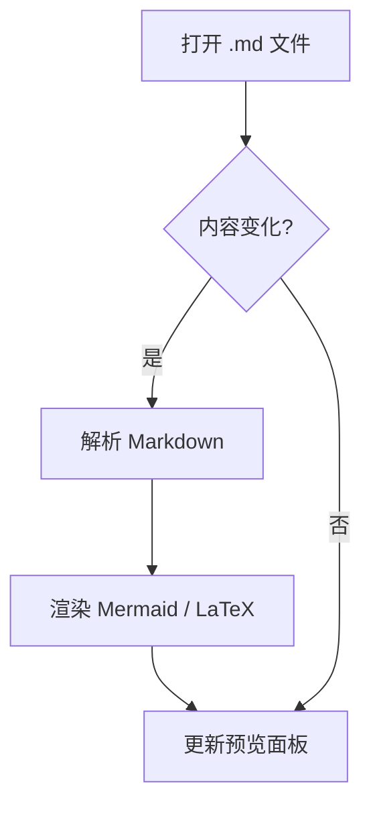
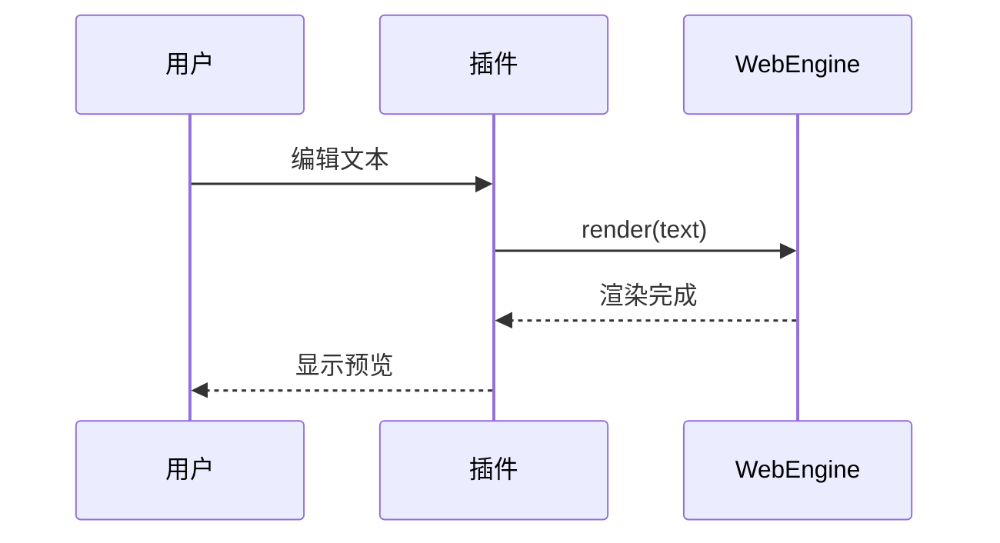
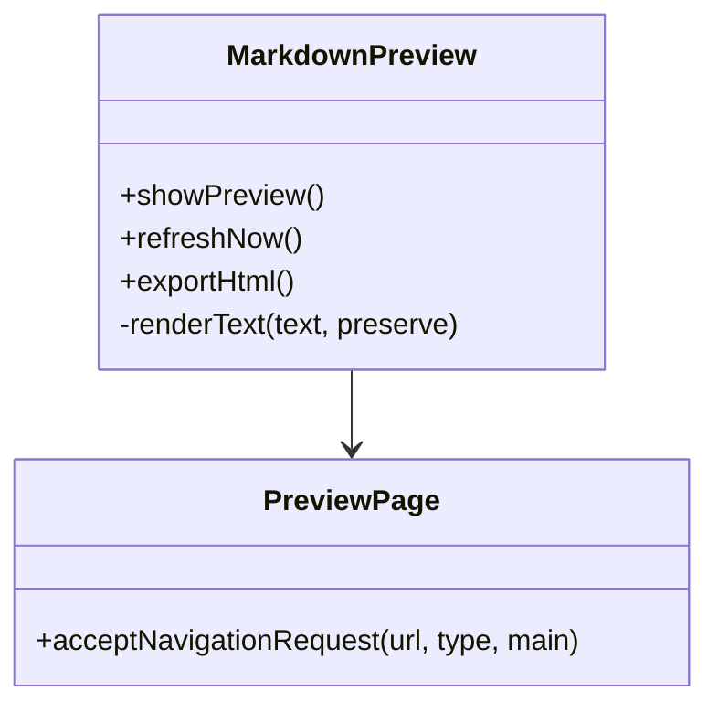
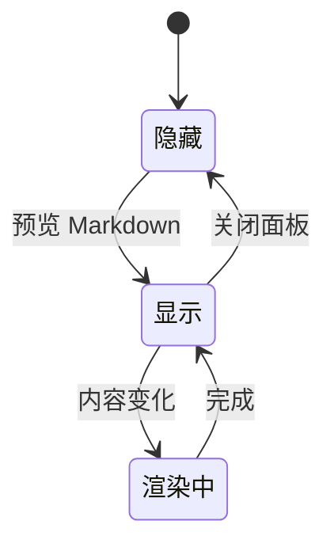
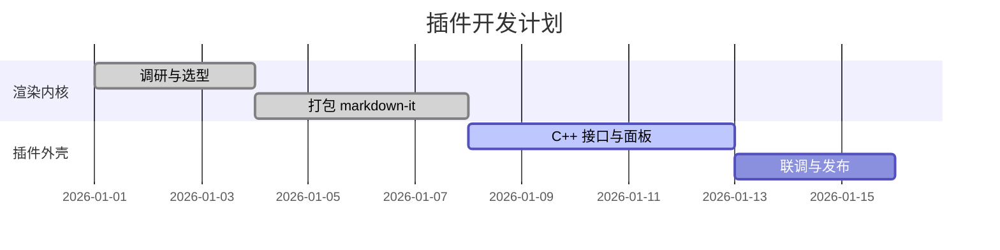
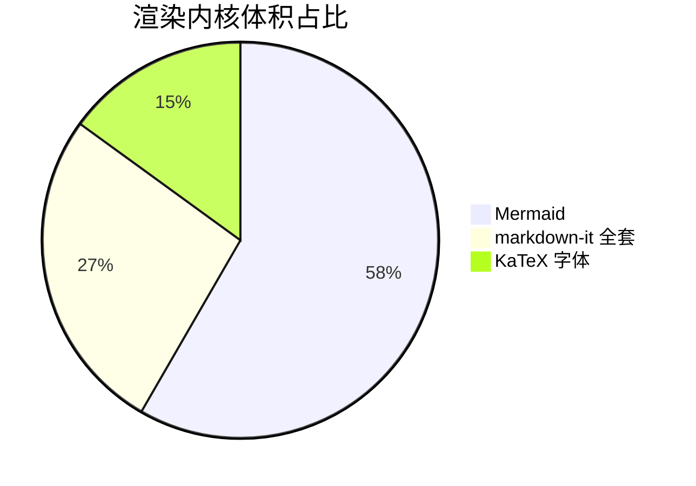
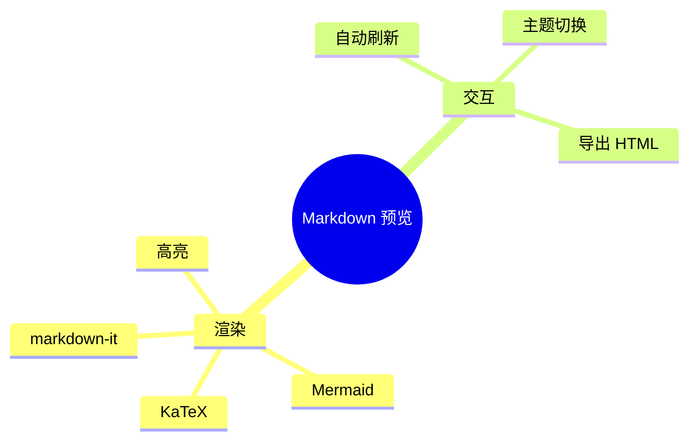

# Notepad-- Markdown 预览 · 全特性示例

在 Notepad-- 中打开本文件，选择插件菜单 **「预览 Markdown」**（`Ctrl+Alt+P`），
即可在右侧面板看到下列所有语法的渲染效果。

[TOC]

---

## 1. 基础排版

普通段落，包含 **加粗**、*斜体*、~~删除线~~、`行内代码`，
以及自动识别链接 https://gitee.com/ndd-community 。

> 这是一段引用。
>
> > 支持嵌套引用。

---

## 2. GFM 表格

| 左对齐 | 居中 | 右对齐 |
|:-------|:----:|-------:|
| Apple  | 100  |   3.14 |
| Banana | 200  |  2.718 |
| Cherry | 300  |      1 |

## 3. 任务列表

- [x] 支持 Markdown 全扩展
- [x] 支持 Mermaid
- [x] 支持 LaTeX
- [ ] 待办：接入更多插件

## 4. 行内扩展

缩写示例：HTML 与 W3C 会自动加注解。

==高亮文本==、++插入文本++、H~2~O（下标）、E=mc^2^（上标）、
Emoji :smile: :rocket: :tada:，以及脚注[^note]。

[^note]: 这是脚注内容，会渲染到文末。

## 5. 定义列表

Markdown
: 一种轻量级标记语言。

Mermaid
: 用文本描述并生成图表的工具。

## 6. 缩写定义

*[HTML]: HyperText Markup Language
*[W3C]: World Wide Web Consortium

## 7. 属性与容器

这一段带有自定义 class 与 id。
{.lead #intro}

::: tip
自定义容器（`::: tip`）：可用来写提示、警告等。
:::

::: warning
这是一个 warning 容器。
:::

## 8. GitHub 警告块

> [!NOTE]
> 有用的信息，用户应当知道。

> [!WARNING]
> 紧急信息，需要用户立即关注。

## 9. 代码高亮

```cpp
#include <QWebEngineView>

int main(int argc, char** argv) {
    QApplication app(argc, argv);
    QWebEngineView view;
    view.setUrl(QUrl("qrc:/ndd/preview.html"));
    view.show();
    return app.exec();
}
```

```python
def fib(n: int) -> int:
    a, b = 0, 1
    for _ in range(n):
        a, b = b, a + b
    return a
```

## 10. Mermaid 图表

### 10.1 流程图



### 10.2 时序图



### 10.3 类图



### 10.4 状态图



### 10.5 甘特图



### 10.6 饼图



### 10.7 思维导图



## 11. LaTeX 数学公式

行内公式：质能方程 $E = mc^2$，欧拉恒等式 $e^{i\pi} + 1 = 0$。

块级公式：

$$
\int_{0}^{\infty} e^{-x^{2}}\,dx = \frac{\sqrt{\pi}}{2}
$$

矩阵：

$$
\begin{pmatrix}
a & b \\
c & d
\end{pmatrix}
\begin{pmatrix}
x \\
y
\end{pmatrix}
=
\begin{pmatrix}
ax + by \\
cx + dy
\end{pmatrix}
$$

求和与极限：

$$
\sum_{n=1}^{\infty} \frac{1}{n^{2}} = \frac{\pi^{2}}{6}
\qquad
\lim_{x \to 0} \frac{\sin x}{x} = 1
$$

---

*示例结束。修改本文任意内容，预览面板会自动刷新。*
